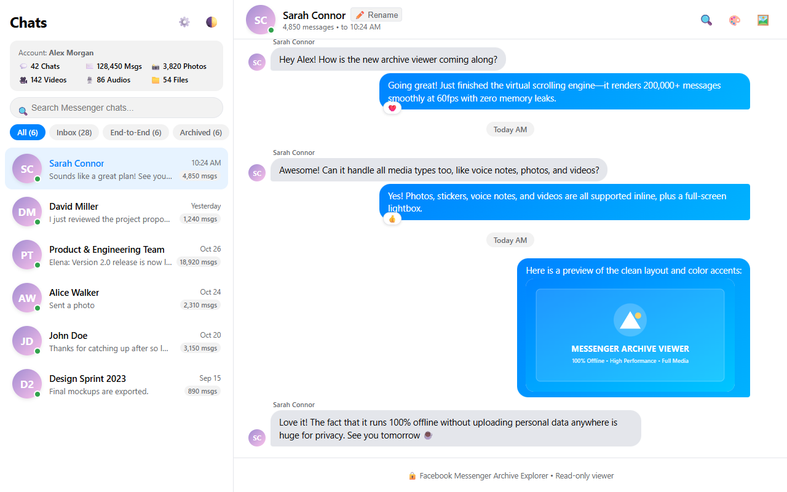

# Facebook Messenger Archive Explorer

> *Born out of the effort to rediscover old messages with an old friend.*

A lightweight, private, client-side web application and local indexer that transforms downloaded Facebook Messenger archives (HTML format) into a fast, modern Facebook Messenger desktop/web interface.


-orange)


---



---

## Important Notice

> **Warning:** This tool is designed and optimized strictly for Facebook data downloads that contain **Messages only**.
> 
> When exporting your data from Facebook, select **"Specific types of information"** and choose only **Messages**. Including other categories (Posts, Comments, Profile Info, Ads, etc.) alters the folder structure and may cause indexing errors or failures.

---

## Features

- **Multi-Conversation Navigation**: Browse all chat threads organized by category:
  - Inbox
  - End-to-End Encrypted (E2EE)
  - Archived Threads
  - Message Requests
  - Group Chats
- **Contact Alias & Rename Manager**:
  - Assign real names to deleted or deactivated accounts that Facebook exports as `Facebook User` or `Người dùng Facebook`.
  - Click the **Rename** button in the chat header to set custom aliases that persist locally in your browser.
- **High-Performance Virtual Scrolling**:
  - Effortlessly handles archives with **over 200,000+ messages** and gigabytes of media without lag or memory leaks.
- **Media Support**:
  - **Photos**: Inline thumbnails with click-to-open fullscreen lightbox (zoom, keyboard navigation, and download).
  - **Stickers & GIFs**: Embedded inline sticker display.
  - **Voice Notes**: Native audio player with seek bar and timestamps.
  - **Videos**: In-bubble video player with playback controls.
  - **Files & Documents**: Attachment cards with direct download links.
- **In-Chat & Global Search**: Instant client-side search across conversations with keyword highlighting and match jumping.
- **Shared Media Gallery**: Slide-out drawer with dedicated tabs for Photos, Videos, Voice Notes, and Documents.
- **Appearance & Themes**:
  - Light and Dark modes with persistent preference.
  - 5 Messenger color accents: Classic Blue, Ocean Teal, Sweet Rose, Neon Violet, Sunset Amber.
- **100% Private & Offline**:
  - All processing runs entirely on your local machine.
  - Zero external network requests or tracking.

---

## Quick Start

### Expected Folder Structure

After unzipping your Facebook export, you will have a folder structure like this:

```text
facebook-<username>-<date>-<id>/   <--- SELECT THIS FOLDER
  ├── your_facebook_activity/
  │     └── messages/
  │           ├── inbox/
  │           ├── e2ee_cutover/
  │           ├── archived_threads/
  │           └── message_requests/
```

### Method 1: Python Launcher (Recommended for Large Archives)

Requires Python 3.8+:

1. **Option A (One-Click Windows)**:
   - Double-click `run.bat`.
   - A folder selection window will appear. Select the top-level folder extracted from Facebook (`facebook-<username>-...`).
   - The tool will index all conversations and automatically launch `http://localhost:8000` in your default browser.
2. **Option B (Command Line)**:
   ```bash
   python viewer.py "/path/to/your/facebook-extracted-folder"
   ```

### Method 2: Zero-Install Browser Mode (No Python Required)

1. Open `index.html` directly in any modern browser (Chrome, Edge, Firefox, Brave).
2. Click **Select Facebook Folder**.
3. Choose the top-level extracted Facebook folder (`facebook-<username>-...`).
4. Your conversations will be indexed and displayed in the sidebar.

---

## Renaming Lost or Deleted Accounts

When a Facebook friend's account has been deactivated, deleted, or suspended, Facebook exports their name as `Facebook User` or `Người dùng Facebook`.

To restore their real identity:
1. Select the conversation in the sidebar.
2. Click the **Rename** button in the top chat header.
3. Type the real name (e.g. `John Doe`) and click **Save Name**.
4. The name will update across the app and is saved in your browser's local storage.
5. Manage or reset custom aliases anytime via the **Settings** icon in the sidebar header.

---

## How to Export Facebook Messages Correctly

To generate an export file compatible with this tool:

1. Go to Facebook **Settings & Privacy** &rarr; **Accounts Center** &rarr; **Your information and permissions** &rarr; **Download your information**.
2. Click **Download or transfer information**.
3. Select **Specific types of information** and check **Messages only** (do not select other data types).
4. Configure download settings:
   - **Format**: `HTML`
   - **Media quality**: `High` (preserves photos, videos, and voice recordings)
   - **Date range**: `All time`
5. Submit the request. Once Meta finishes preparing the download, download and unzip the archive to your computer.

---

## License

This project is licensed under the [MIT License](LICENSE).
